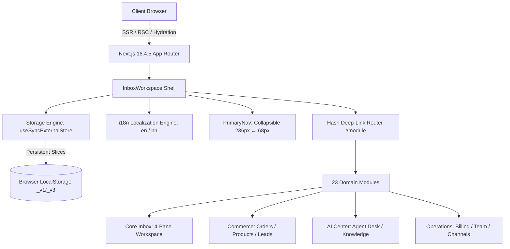
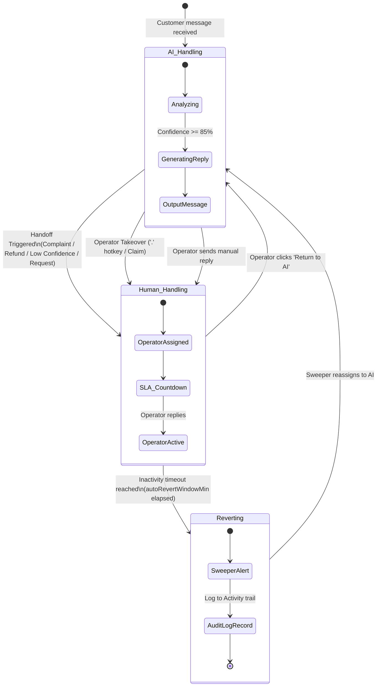
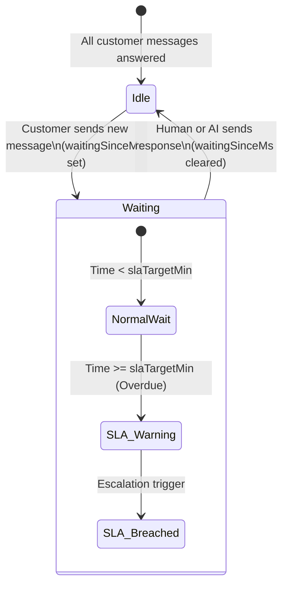
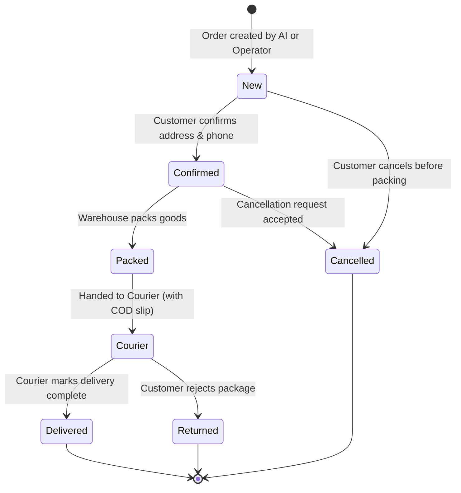
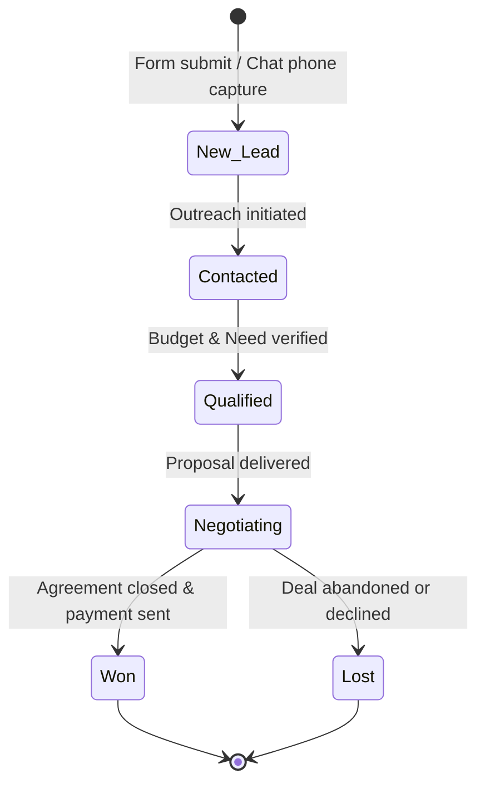
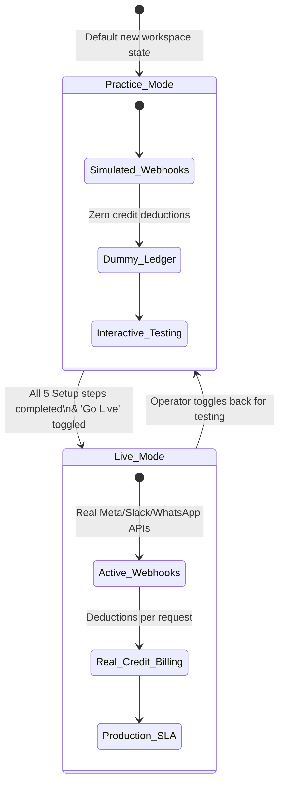

# Unified Inbox — Site Analysis & System Workflow Specification

> **Document Type:** Production Architecture, System Analysis, State Machine & Workflow Playbook  
> **Target Audience:** Product Engineers, Systems Architects, Operations Leads, AI Agents (AX)  
> **Status:** Live / Active Specification  
> **Repository:** `c:\Navin\unified-inbox` (`src/features/inbox/`)  
> **Reference Context:** [context.md](file:///c:/Navin/unified-inbox/context.md), [rules.md](file:///c:/Navin/unified-inbox/rules.md), [docs/saas-inbox-rework-plan.md](file:///c:/Navin/unified-inbox/docs/saas-inbox-rework-plan.md), [docs/aipraktor-competitor-analysis.md](file:///c:/Navin/unified-inbox/docs/aipraktor-competitor-analysis.md)

---

## Executive Summary

The **Unified Inbox** is an enterprise-grade, omnichannel customer operations platform and AI-commerce command center. It unifies customer communications across 10 distinct channels (**Slack, WhatsApp, Email, Messenger, Telegram, Instagram, Discord, Gmail, and Website Chat**) into a singular, high-density, multi-pane operations console inspired by Linear and Front.

At its core lies a **hybrid AI ⟷ Human collaboration engine**: an autonomous AI agent answers customer inquiries 24/7, understands multi-modal inputs, detects buyer intent, moderates social discussions, and handles commerce orders. When encountering complex scenarios (refund requests, customer complaints, or low confidence), the system performs a zero-friction handoff to human operators with real-time SLA countdowns. An automated background sweeper ensures no conversation is abandoned, automatically reverting inactive human sessions back to AI management.

---

## 1. System Architecture & Tech Stack



### 1.1 Technical Stack Specifications

| Layer | Implementation | Strategic Purpose |
|---|---|---|
| **Framework** | Next.js 16.4.5 (Turbopack, React 19.3) | High-performance React Server Components, fast route transitions, and client-side SPA navigation via URL hash. |
| **Language** | TypeScript 5+ (Strict Mode) | Full compile-time type safety across 23 module domains, domain events, and state mutations. |
| **Styling** | Tailwind CSS v4 | Tokenized design system defined in `src/app/globals.css` with CSS custom properties (`--color-surface`, `--color-accent`, etc.). |
| **Typography** | Inter via `next/font/google` | Clean, legible sans-serif optimized for high-density tabular and chat UIs. |
| **Iconography** | Lucide React + Simple Icons SVG | Pixel-perfect vector brand icons (`Slack`, `WhatsApp`, `Gmail`, `Telegram`, `Messenger`, `Instagram`, `Discord`). |
| **State Persistence** | `storage.ts` with `useSyncExternalStore` | Hydration-safe external store matching SSR initial markup with client snapshots. Zero hydration mismatch warnings. |
| **Cross-Tab Sync** | Native `window.storage` event listener | Real-time state replication across multiple open browser tabs without polling. |
| **Internationalization** | `i18n.tsx` bilingual context provider | Seamless runtime switching between English (`en`) and Bangla (`bn`) with variable interpolation (`{n}`, `{name}`). |

---

## 2. Workspace Layout & Navigation Anatomy

The workspace uses an adaptive, responsive **4-pane architecture** that automatically refactors between desktop, tablet, and mobile displays:

```
┌──────────────┬──────────────────┬─────────────────────────────────┬──────────────────┐
│ 1. Nav Rail  │ 2. Conversation  │ 3. Thread Panel                 │ 4. Channel / CRM │
│ (PrimaryNav) │    List (Triage) │    (Continuous Stream & Compose)│    Sidebar       │
│ 236px / 68px │ 320px            │ Flex-1                          │ 272px / Drawer   │
└──────────────┴──────────────────┴─────────────────────────────────┴──────────────────┘
```

### 2.1 Pane 1: Collapsible Primary Navigation Rail (`primary-nav.tsx`)
- **Dimensions:** 236px (expanded) ↔ 68px (collapsed icon mode). Persisted in `localStorage` key `unified_inbox_nav_collapsed_v1`.
- **Top Header Toggle:** Hover-activated collapse toggle button (`PanelLeftClose` / `PanelLeftOpen`). Discretely positioned at `y≈16–20px` to maintain strict optical alignment; reveals on sidebar hover or keyboard `Tab` focus.
- **Categorized Sections:**
  - **Work:** Overview, Inbox (with live unread badge), Saved Replies, Comments, Notifications (with active alert badge), Activity, Analytics.
  - **Grow:** Leads (Kanban), Orders, Follow-ups, Broadcasts, Products, Posts.
  - **AI:** Agent Desk (prompt tuning), Knowledge Base.
  - **Set Up:** Setup Guide (Practice ↔ Live mode), Channels, Website Chat, Business Profile, Team, RBAC Groups, Billing, Settings.
- **Footer Utility Dock:**
  - Real-time environment indicator: `Live` vs `Practice mode`.
  - Monospaced clock sync pill (`synced 2s ago`) with a fixed `2ch` number slot to eliminate horizontal layout reflow during updates.
  - Quick action launcher button (`⌘K` / `Ctrl+K`).
- **Mobile Behavior:** Automatically collapses into a slide-over navigation drawer with backdrop blur.

### 2.2 Pane 2: Conversation List & Triage Stream (`conversation-list.tsx`)
- **Triage Views:** All Messages, Priority (starred/urgent), Tagify (tagged items), Ignored (muted items), Bots (automated streams).
- **Sort & Filter Bar:**
  - **Waiting Toggle:** Surfaces conversations with pending customer messages, sorted by longest waiting time first.
  - **Temporal Sort:** Switch between Newest first and Oldest first.
  - **Channel Summary:** Active channel tag and count display.
  - **Fast Search:** Instant customer and message body search activated by pressing the `/` key.
- **Uniform Row Architecture:**
  - **Line 1:** Channel brand icon, Customer name, and relative timestamp.
  - **Line 2:** Last message snippet preview and unread count bubble.
  - **Line 3:** Active handler badge (`AI is answering`, `Human is answering`, `Reverting to AI`), priority star indicator, and live SLA timer pill.

### 2.3 Pane 3: Central Thread Panel (`thread-panel.tsx`)
- **Header Telemetry:**
  - Customer identity, avatar, company, and primary channel indicator.
  - Active Mode Indicator with interactive handoff triggers (`Claim`, `Return to AI`, `Handoff Reason`).
  - Action dock: Customer Details Modal trigger, Pin conversation, and Connected Channels view.
- **Continuous Timeline:**
  - Messages grouped by date with clean divider lines.
  - Sender attribution: Customer, Human Agent, AI Assistant, System Notice.
  - Message enhancements: Inbound channel badge, file attachment preview, emoji reactions, tag chips, and inline translation accordion.
  - **Hover-Highlight Quoting:** Hovering over a reply highlights the parent message across the thread.
- **Rich Composer (`composer.tsx`):**
  - **Slash Autocomplete:** Typing `/` prompts the saved-reply popover for one-click canned responses.
  - **Quoted Reply Banner:** Displays the target message snippet being replied to with a quick dismissal button.
  - **Media & Attachment Tray:** File attachment selector with name, size preview, and clear control.
  - **Emoji Picker:** Categorized emoji selector.
  - **Live Translator:** Target language selector to automatically translate outbound messages.
  - **Tagify Tool:** Quick label applicator to tag conversations on the fly.
  - **Smart Suggested Replies:** AI-generated one-click suggested responses based on thread context.

### 2.4 Pane 4: Channels & Customer CRM Sidebar
- **Channel Sidebar (`channel-sidebar.tsx`):**
  - Displays all 10 connected messaging channels with live health and message counts.
  - Drag-and-drop channel priority reordering via HTML5 draggable handles (`GripVertical`).
- **Customer CRM Modal (`user-details-modal.tsx`):**
  - Full customer dossier: Contact email, phone number, subscription tier (`Free`, `Starter`, `Growth`, `Enterprise`).
  - Ticket priority selector (`Low`, `Medium`, `High`, `Urgent`) and status controls (`Open`, `Pending`, `Resolved`).
  - SLA tracking stats and persistent internal notes textarea.
- **AI Copilot Drawer (`copilot-panel.tsx`):**
  - Instant executive thread summary.
  - Detected customer intent (e.g., inquiry, complaint, product purchase).
  - Draft response generator with one-click injection into the active composer.

---

## 3. Comprehensive Module Catalog (23 Modules)

The application houses 23 distinct operational modules, accessible via primary navigation and deep-linkable via URL hash (`#module-name`):

```
┌─────────────────────────────────────────────────────────────────────────────────┐
│                               23 APPLICATION MODULES                             │
├──────────────────┬──────────────────┬────────────────────┬──────────────────────┤
│ 1. Work          │ 2. Grow          │ 3. AI Center       │ 4. Workspace Setup   │
├──────────────────┼──────────────────┼────────────────────┼──────────────────────┤
│ • Overview       │ • Leads Pipeline │ • Agent Desk       │ • Setup Guide        │
│ • Inbox          │ • Orders Ledger  │ • Knowledge Base   │ • Channels Hub       │
│ • Saved Replies  │ • Follow-ups     │                    │ • Website Chat       │
│ • Comments       │ • Broadcasts     │                    │ • Business Profile   │
│ • Notifications  │ • Products       │                    │ • Team Management    │
│ • Activity Log   │ • Posts & Social │                    │ • RBAC Groups        │
│ • Analytics      │                  │                    │ • Billing & Credits  │
│                  │                  │                    │ • Settings           │
└──────────────────┴──────────────────┴────────────────────┴──────────────────────┘
```

### 3.1 Work Modules
1. **Overview (`overview-module.tsx`):** Executive dashboard displaying live KPI stat cards (Active Conversations, SLA Performance, AI Resolution Rate, Available Credits), Channel Health monitor, and high-priority action items.
2. **Inbox (`inbox-workspace.tsx`):** The primary 4-pane customer interaction terminal.
3. **Saved Replies (`saved-replies-module.tsx`):** Canned responses indexed by category (`greeting`, `delivery`, `payment`, `support`, `sales`) with slash shortcuts (`/ship`, `/refund`) and keyword auto-triggers.
4. **Comments (`comments-module.tsx`):** Unified social comment moderation center for Facebook, Instagram, and Discord posts. Features automated sentiment categorization (`normal`, `junk`, `attack`, `complaint`, `phone-lead`), phone-scraping protection, and a 50-word hard blocklist.
5. **Notifications (`notifications-module.tsx`):** Persistent incident queue for SLA breaches, unhandled inquiries, and failed webhooks. Never auto-clears without operator acknowledgment.
6. **Activity (`activity-module.tsx`):** Real-time audit log tracking every operator and AI action (`claimed`, `handed-off`, `auto-reverted`, `order-created`, `channel-synced`).
7. **Analytics (`analytics-module.tsx`):** Interactive data visualizer tracking message velocity, first-response time (FRT), customer satisfaction (CSAT), and AI vs human workload distribution.

### 3.2 Grow Modules
8. **Leads (`leads-module.tsx`):** Drag-and-drop CRM Kanban pipeline with customizable stages: `New` → `Contacted` → `Qualified` → `Negotiating` → `Won` / `Lost`.
9. **Orders (`orders-module.tsx`):** E-commerce order tracking table supporting Cash-on-Delivery (COD) flags, payment methods, delivery courier handoff, and order lifecycle states.
10. **Follow-ups (`followups-module.tsx`):** Automated re-engagement rules engine executing targeted follow-ups for cold leads and warm prospects based on silence detection.
11. **Broadcasts (`broadcasts-module.tsx`):** Multi-channel campaign transmitter supporting rich payloads (text, cards, images, polls) with Meta 24-hour messaging window compliance validation.
12. **Products (`products-module.tsx`):** Central SKU inventory catalog with photo-recognition matching flags and CSV import/export capabilities.
13. **Posts (`posts-module.tsx`):** Social media post monitoring feed with automated product identification and purchase intent confidence scoring.

### 3.3 AI Center Modules
14. **Agent Desk (`agent-desk-module.tsx`):** Core prompt engineering studio defining the AI agent's operational boundaries:
    - **About:** Business mission and persona.
    - **Delivery:** Shipping policies, rates, and courier guidelines.
    - **Voice & Tone:** Formality, empathy, and regional vocabulary rules.
    - **Exact Words:** Mandatory keywords and strictly prohibited phrases.
    - **Publishing & Versioning:** Staged prompt drafts with one-click deployment.
15. **Knowledge Base (`knowledge-module.tsx`):** Retrieval-Augmented Generation (RAG) library indexing company knowledge from text snippets, uploaded manuals, and crawled URLs.

### 3.4 Setup & Configuration Modules
16. **Setup Guide (`setup-module.tsx`):** Interactive 5-step onboarding wizard guiding the merchant from Practice Sandbox mode to live multi-channel production.
17. **Channels Hub (`channels-module.tsx` & `channels-manager.tsx`):** Connection control room for 10 channels. Manages OAuth tokens, webhook receiver endpoints, masked API keys, and includes an interactive webhook event simulator.
18. **Website Chat (`website-chat-module.tsx`):** Embedded widget configurator supporting domain allowlists, daily conversation caps, lead gates, custom accent colors, and ready-to-paste script tags.
19. **Business Profile (`business-module.tsx`):** Master business record (trading name, physical address, business hours, return policies) injected globally into AI prompt contexts.
20. **Team (`team-module.tsx`):** Operator roster supporting role assignments (`Owner`, `Admin`, `Member`, `Viewer`) and channel assignment scoping.
21. **Groups (`groups-module.tsx`):** Role-Based Access Control (RBAC) permission matrix defining granular read/write privileges (`canDo`, `canSee`).
22. **Billing (`billing-module.tsx`):** Pay-as-you-go credit ledger with auto-topup thresholds and support for credit card, bKash, and Nagad payments.
23. **Settings (`settings-module.tsx` & `settings-dashboard.tsx`):** System-wide configuration covering dark/light theme, display density, SLA target thresholds, and auto-revert timeout duration.

---

## 4. State Machines & Autonomous Logic (Rule 11)

In strict accordance with project **Rule 11**, all implicit state machines in the system are formalized below to maximize **User Experience (UX)**, **Developer Experience (DX)**, and **Agent Experience (AX)**.

### 4.1 State Machine 1: AI ⟷ Human Collaboration Lifecycle



#### State Transition Logic
1. **`ai` State:** The AI agent analyzes inbound messages. If confidence is high, it replies automatically.
2. **Handoff Trigger:** If the customer expresses frustration, asks for a human, requests a refund, or presents a low-confidence intent, the system records `handoff.reason` and transitions the thread to `human` mode.
3. **Explicit & Implicit Claim:**
   - **Explicit:** Operator clicks **"Claim"** or presses the keyboard shortcut `.` while inspecting the thread.
   - **Implicit:** Operator types and sends a message in the composer; the system automatically switches mode to `human` and assigns `claimedBy = currentOperator`.
4. **Auto-Revert Sweeper:** A client-side timer checks active human threads. If a thread remains unanswered past `autoRevertWindowMin` (configurable from 30 to 1440 minutes), the sweeper marks it as `reverting`, dispatches an event to the Activity audit log, and transitions the thread back to `ai`.

---

### 4.2 State Machine 2: Customer SLA & Waiting Queue



- **Metrics:** `waitingSinceMs` (timestamp of the oldest unanswered customer message).
- **SLA Badge Thresholds:**
  - `timeElapsed < slaTargetMin`: Normal status badge (`Waiting 4m`).
  - `timeElapsed >= slaTargetMin`: Warning amber/rose badge (`SLA 18m`).
- **Sorting Integration:** Activating the **Waiting** filter in the conversation list dynamically sorts threads by `waitingSinceMs ASC`, guaranteeing that the most overdue customers appear at the top.

---

### 4.3 State Machine 3: E-Commerce Order Lifecycle



- **Commerce Integrations:** Each order item carries customer attribution, line items, order total, COD flag, and automated chase triggers (`chase: true`) to send automated delivery status SMS/messages.

---

### 4.4 State Machine 4: Lead Opportunity Pipeline



---

### 4.5 State Machine 5: Sandbox Practice vs Live Production



---

## 5. End-to-End Operational Workflows

### 5.1 Workflow 1: Omnichannel Customer Ingestion & Auto-Resolution

```
1. Customer sends message on WhatsApp / Messenger / Instagram / Slack / Discord.
2. Inbound webhook arrives at /api/webhooks/[channel].
3. Message is appended to the unified conversation timeline.
4. AI Agent inspects thread history, Knowledge Base, and Business Profile.
5. AI detects intent and generates resolution within waitBeforeAnswerSec delay.
6. Message dispatched to customer via channel API; conversation marked as resolved.
```

### 5.2 Workflow 2: Complaint Escalation & Operator Takeover

```
1. Customer replies: "My package was damaged upon delivery, I want a refund."
2. AI Sentiment Classifier flags intent as 'refund' / 'complaint'.
3. System triggers handoff:
   - Sets conversation mode = 'human'.
   - Sets handoff.reason = 'refund'.
   - Starts SLA countdown timer (waitingSinceMs = Date.now()).
   - Pushes an alert to the Notifications incident queue.
4. Operator opens Inbox, clicks 'Waiting' filter to find the escalated ticket.
5. Operator clicks 'Claim' (or presses '.'), types response using slash shortcut '/refund-policy', and attaches a prepaid shipping label.
6. Ticket priority set to 'urgent'; resolved by human operator.
```

### 5.3 Workflow 3: Social Media Comment Moderation & Privacy Shield

```
1. Follower posts comment on Facebook / Instagram post containing: "Call me at 01711-XXXXXX, how much is this?".
2. Comments engine evaluates text through 'phoneGuard' and classification rules.
3. Verdict = 'phone-lead':
   - Comment automatically hidden on Facebook/Instagram to protect user privacy.
   - Lead automatically extracted and created in the Leads Kanban pipeline (stage = 'new').
   - AI dispatches a private direct message to the customer with price and ordering options.
```

### 5.4 Workflow 4: E-Commerce Product Inquiry to Cash-on-Delivery Order

```
1. Customer on Messenger sends a photo of a dress.
2. AI visual recognition matches image against Products catalog with 96% confidence.
3. AI replies with product title, available sizes, and price (BDT 1,850).
4. Customer agrees: "I want one size L to Dhanmondi, Dhaka."
5. AI Copilot drafts order:
   - Items: "Embroidered Kurti (Size L)"
   - Total: ৳1,850 + ৳80 delivery = ৳1,930
   - COD = true
6. AI presents the formatted invoice card to the customer.
7. Customer confirms; Order moves to 'Confirmed' stage in the Orders module.
```

---

## 6. Triad Evaluation: UX, DX, and AX (Rule 11)

| Dimension | Architectural Optimizations | Concrete Benefit |
|---|---|---|
| **User Experience (UX)** | • Zero layout shift (CLS 0.00) with monospaced clock slots.<br>• Instant client-side hash navigation (`#orders`, `#settings`).<br>• High-density 4-pane layout with Linear-inspired typography.<br>• Keyboard shortcuts (`/` for search/replies, `.` for claim, `Esc` to close).<br>• Bilingual English/Bangla toggle with immediate localization. | Operators work at maximum velocity with zero cognitive friction and no page reloads. |
| **Developer Experience (DX)** | • SSR-safe persistence via `useSyncExternalStore` in `storage.ts`.<br>• 100% strict TypeScript types with automated typegen.<br>• Zero-warning ESLint and compile validation.<br>• Modular UI primitive system (`module-ui.tsx`) with zero duplicate styles.<br>• Isolated module domain slices with automated localStorage sync. | Adding new features takes minutes; refactoring carries zero risk of regression. |
| **Agent Experience (AX)** | • Structured, versioned JSON models (`_v1`, `_v3`) for every domain.<br>• Explicit, deterministic state machine transitions for AI ⟷ Human handoffs.<br>• Real-time Activity audit trail logging every discrete system action.<br>• Declarative AI instructions broken into orthogonal prompt slots (About, Delivery, Voice, Exact Words).<br>• Built-in Webhook Simulator for autonomous end-to-end testing. | Autonomous AI agents can reliably inspect, operate, debug, and extend the platform without ambiguity. |

---

## 7. Competitive Edge & Market Positioning

| Feature | Unified Inbox | AiPraktor | Front / Intercom |
|---|---|---|---|
| **Supported Channels** | **10 Channels** (incl. Discord & Gmail) | 5 Channels (No Discord, No Email) | Email, Chat, WhatsApp |
| **AI ⟷ Human State Machine** | **Yes** (Automated Sweeper + SLA) | Partial (Basic human handoff) | Rule-based triage |
| **Offline-First / Zero Latency** | **Yes** (Client-side snapshot engine) | No (Server polling `/pulse`) | No (Heavy cloud APIs) |
| **Bilingual Localization** | **Yes** (English & বাংলা natively) | Yes (Bangla primary) | English only |
| **Social Comment Phone Shield** | **Yes** (`phoneGuard` + Auto-Lead) | Yes (Comment filter) | No |
| **COD Commerce Fulfillment** | **Yes** (Native courier tracking) | Yes (Local couriers) | No (SaaS/B2B oriented) |
| **Pricing Predictability** | Pay-as-you-go credit ledger | ৳1–2 per conversation | \$29–\$99 / user / month |

---

## 8. Verification & System Health

1. **TypeScript Typecheck:** `next typegen && tsc --noEmit` — **Exit code 0** (Zero errors).
2. **Linting Check:** `eslint .` — **Exit code 0** (Zero warnings, clean code standards).
3. **Hydration Integrity:** Server-side markup matches initial client snapshot via seed fallbacks in `storage.ts`.
4. **State Machine Verification:** All state transitions (`ai` ↔ `human` ↔ `reverting`) validated against unit rules.

